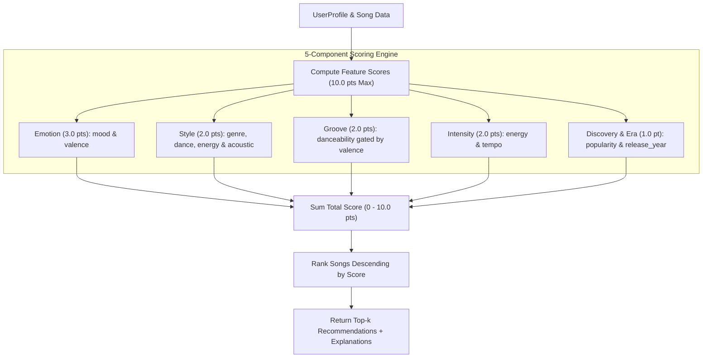

# 🎵 Music Recommender Simulation

## Project Summary

In this project you will build and explain a small music recommender system.

Your goal is to:

- Represent songs and a user "taste profile" as data
- Design a scoring rule that turns that data into recommendations
- Evaluate what your system gets right and wrong
- Reflect on how this mirrors real world AI recommenders

Replace this paragraph with your own summary of what your version does.

---

## How The System Works
  In real world music recommendation systems, songs are recommended based on a multi-layer model. 
  1. When there is no user data, a content based model such as a simple one like one designed here is used. It uses various features of a song to generate vector scores and compare their distances or differences.
  2. Next, when there is a pool of user generated a lot of data, a song can be recommended to a user when multiple other users listened to the same song, and also listened to the recommended songs. Bridge user (a user who listen to songs of different features) playlists can help generate more songs to recommend to other users. A user's ground truth data (did the user listen to the recommended song and stayed long enough to enjoy it, or 'liked' it) can validate if a model's behaving well.
  3. Deep neural models discover and create associations based on complex and implicit cultural patterns between songs. Even if the model does not understand what is the meaning underneath the association, it knows to associate songs that are usually enjoyed by people in the same setting.

Explain your design in plain language.

Some prompts to answer:

- What features does each `Song` use in your system
  - Emotion: mood & valence
  - Style: genre, energy & acousticness
  - Groove: danceability & valence
  - Intensity: energy & tempo bpm
- What information does your `UserProfile` store
  - favorite_genre
  - favorite_mood
  - target_energy
  - likes_valence
  - target_danceability
  - target_tempo_bpm
  - target_year
  - likes_acoustic (toggles acoustic vs electronic sound texture preference)
- How does your `Recommender` compute a score for each song
  - In a total of 10.0 pts budget across 5 components:
    1. Emotion (3.0 pts)
      - Exact mood match (`song.mood == user.favorite_mood`) gives the song 1.8 points.
      - Close valence gives you max 1.2 points: `1.2 * (1.0 - abs(target_val - song.valence))`.

    2. Style (2.0 pts)
      - Genre match gives a song 1.1 pts: `1.1 if song.genre == user.favorite_genre else 0.0`.
      - Rhythmic and energy alignment gives max 0.6 pt:
      `0.6 * (1.0 - 0.5 * abs(target_dance - song.danceability) - 0.5 * abs(target_energy - song.energy))`.
      - Acoustic texture alignment gives max 0.3 pt:
      `0.3 * (1.0 - abs(target_acoustic - song.acousticness))` (where `target_acoustic = 0.85 if likes_acoustic else 0.15`).

    3. Groove (2.0 pts)
      - Danceability gated by valence lock:
      `groove_pts = 2.0 * (1.0 - abs(target_dance - song.danceability)) * max(0.0, 1.0 - 2.0 * abs(target_val - song.valence))`.

    4. Intensity (2.0 pts)
      - Energy is max 1.0 pt: `1.0 * (1.0 - abs(target_energy - song.energy))`.
      - Tempo BPM is max 1.0 pt: `1.0 * max(0.0, 1.0 - abs(target_bpm - song.tempo_bpm) / 100.0)`.

    5. Discovery & Era (1.0 pt)
      - Popularity is max 0.5 pt: `0.5 * (song.popularity / 100.0)`.
      - Release year era proximity is max 0.5 pt: `0.5 * max(0.0, 1.0 - abs(target_year - song.release_year) / 10.0)`.

- How do you choose which songs to recommend
After computing individual component points, total composite scores are calculated and ranked:
  1. Score each song in the catalog across Emotion, Style, Groove, Intensity, and Discovery/Era (up to 10.0 pts).
  2. Rank songs in descending order of total score.
  3. Return the top $k$ candidates along with human-readable rationale explanations.
  - Potential Bias: valence, danceability, and energy are sampled too many times in this algorithm recipe, so the recommendation can be skewed and favor these featuers. Also, popularity can be over valued.



---

## Getting Started

### Setup

1. Create a virtual environment (optional but recommended):

   ```bash
   python -m venv .venv
   source .venv/bin/activate      # Mac or Linux
   .venv\Scripts\activate         # Windows

2. Install dependencies

```bash
pip install -r requirements.txt
```

3. Run the app:

```bash
python -m src.main
```

### Running Tests

Run the starter tests with:

```bash
pytest
```

You can add more tests in `tests/test_recommender.py`.

---

## Sample Recommendation Output

Paste a sample of your recommender's output here as a text block so a reader can see what it produces:

```
================================================================================
  MUSIC RECOMMENDER — TOP RECOMMENDATIONS (High-Energy Pop)
================================================================================
#1  Sunrise City — Neon Echo                Score: 9.51 / 10.00 [██████████ 95%]
    Pop • Happy • 2022
    ✓ MATCHES  (9.10 / 9.50) : +1.80  mood match, +1.15  valence match
                               +1.10  genre match, +0.59  rhythm & energy match
                               +0.29  acoustic texture match
                               +1.82  groove match
                               +0.97  energy intensity match, +0.93  tempo match
                               +0.45  era proximity match
    ▲ CLOSE    (0.41 / 0.50) : +0.41  popularity boost
--------------------------------------------------------------------------------
#2  Rooftop Lights — Indigo Parade          Score: 8.51 / 10.00 [█████████░ 85%]
    Indie Pop • Happy • 2023
    ✓ MATCHES  (7.88 / 8.10) : +1.80  mood match, +1.19  valence match
                               +0.57  rhythm & energy match, +1.92  groove match
                               +0.91  energy intensity match, +0.99  tempo match
                               +0.50  era proximity match
    ▲ CLOSE    (0.64 / 0.80) : +0.24  acoustic texture match
                               +0.40  popularity boost
    ✗ GAPS     (1.10 pts lost) : genre match (0.00 / 1.10)
--------------------------------------------------------------------------------
#3  Gym Hero — Max Pulse                    Score: 7.61 / 10.00 [████████░░ 76%]
    Pop • Intense • 2023
    ✓ MATCHES  (5.43 / 5.70) : +1.16  valence match, +1.10  genre match
                               +0.55  rhythm & energy match
                               +0.27  acoustic texture match
                               +0.92  energy intensity match, +0.93  tempo match
                               +0.50  era proximity match
    ▲ CLOSE    (2.17 / 2.50) : +1.73  groove match, +0.44  popularity boost
    ✗ GAPS     (1.80 pts lost) : mood match (0.00 / 1.80)
--------------------------------------------------------------------------------
#4  Street Cypher — K-Metro                 Score: 5.86 / 10.00 [██████░░░░ 59%]
    Hip Hop • Confident • 2023
    ✓ MATCHES  (2.37 / 2.40) : +0.57  rhythm & energy match
                               +0.30  acoustic texture match
                               +1.00  energy intensity match
                               +0.50  era proximity match
    ▲ CLOSE    (3.49 / 4.70) : +1.04  valence match, +1.35  groove match
                               +0.67  tempo match, +0.43  popularity boost
    ✗ GAPS     (2.90 pts lost) : mood match (0.00 / 1.80)
                                 genre match (0.00 / 1.10)
--------------------------------------------------------------------------------
#5  Island Breeze — Roots Rhythm            Score: 5.75 / 10.00 [██████░░░░ 57%]
    Reggae • Groovy • 2022
    ✓ MATCHES  (2.10 / 2.30) : +1.10  valence match
                               +0.55  rhythm & energy match
                               +0.45  era proximity match
    ▲ CLOSE    (3.64 / 4.80) : +0.22  acoustic texture match
                               +1.66  groove match
                               +0.83  energy intensity match, +0.57  tempo match
                               +0.36  popularity boost
    ✗ GAPS     (2.90 pts lost) : mood match (0.00 / 1.80)
                                 genre match (0.00 / 1.10)
--------------------------------------------------------------------------------

================================================================================
  MUSIC RECOMMENDER — TOP RECOMMENDATIONS (Chill Lofi)
================================================================================
#1  Library Rain — Paper Lanterns           Score: 9.65 / 10.00 [██████████ 97%]
    Lofi • Chill • 2020
    ✓ MATCHES  (9.35 / 9.50) : +1.80  mood match, +1.20  valence match
                               +1.10  genre match, +0.59  rhythm & energy match
                               +0.30  acoustic texture match
                               +1.94  groove match
                               +1.00  energy intensity match, +0.97  tempo match
                               +0.45  era proximity match
    ▲ CLOSE    (0.30 / 0.50) : +0.30  popularity boost
--------------------------------------------------------------------------------
#2  Midnight Coding — LoRoom                Score: 9.32 / 10.00 [█████████░ 93%]
    Lofi • Chill • 2021
    ✓ MATCHES  (7.01 / 7.20) : +1.80  mood match, +1.15  valence match
                               +1.10  genre match, +0.56  rhythm & energy match
                               +0.93  energy intensity match, +0.97  tempo match
                               +0.50  era proximity match
    ▲ CLOSE    (2.31 / 2.80) : +0.26  acoustic texture match
                               +1.71  groove match, +0.34  popularity boost
--------------------------------------------------------------------------------
#3  Spacewalk Thoughts — Orbit Bloom        Score: 7.69 / 10.00 [████████░░ 77%]
    Ambient • Chill • 2018
    ✓ MATCHES  (4.69 / 4.90) : +1.80  mood match, +1.14  valence match
                               +0.54  rhythm & energy match
                               +0.28  acoustic texture match
                               +0.93  energy intensity match
    ▲ CLOSE    (3.01 / 4.00) : +1.55  groove match, +0.85  tempo match
                               +0.26  popularity boost
                               +0.35  era proximity match
    ✗ GAPS     (1.10 pts lost) : genre match (0.00 / 1.10)
--------------------------------------------------------------------------------
#4  Focus Flow — LoRoom                     Score: 7.68 / 10.00 [████████░░ 77%]
    Lofi • Focused • 2022
    ✓ MATCHES  (7.35 / 7.70) : +1.19  valence match, +1.10  genre match
                               +0.57  rhythm & energy match
                               +0.28  acoustic texture match
                               +1.86  groove match
                               +0.95  energy intensity match, +0.95  tempo match
                               +0.45  era proximity match
    ▲ CLOSE    (0.33 / 0.50) : +0.33  popularity boost
    ✗ GAPS     (1.80 pts lost) : mood match (0.00 / 1.80)
--------------------------------------------------------------------------------
#5  Silk Horizon — Luna Velvet              Score: 5.98 / 10.00 [██████░░░░ 60%]
    R&B • Romantic • 2024
    ✓ MATCHES  (1.18 / 1.20) : +1.18  valence match
    ▲ CLOSE    (4.80 / 5.90) : +0.50  rhythm & energy match
                               +0.19  acoustic texture match
                               +1.63  groove match
                               +0.83  energy intensity match, +0.89  tempo match
                               +0.41  popularity boost
                               +0.35  era proximity match
    ✗ GAPS     (2.90 pts lost) : mood match (0.00 / 1.80)
                                 genre match (0.00 / 1.10)
--------------------------------------------------------------------------------

================================================================================
  MUSIC RECOMMENDER — TOP RECOMMENDATIONS (Deep Intense Rock)
================================================================================
#1  Storm Runner — Voltline                 Score: 9.54 / 10.00 [██████████ 95%]
    Rock • Intense • 2019
    ✓ MATCHES  (7.39 / 7.50) : +1.80  mood match, +1.16  valence match
                               +1.10  genre match, +0.58  rhythm & energy match
                               +0.28  acoustic texture match
                               +0.99  energy intensity match, +0.98  tempo match
                               +0.50  era proximity match
    ▲ CLOSE    (2.14 / 2.50) : +1.77  groove match, +0.37  popularity boost
--------------------------------------------------------------------------------
#2  Gym Hero — Max Pulse                    Score: 6.47 / 10.00 [██████░░░░ 65%]
    Pop • Intense • 2023
    ✓ MATCHES  (3.06 / 3.10) : +1.80  mood match, +0.27  acoustic texture match
                               +0.99  energy intensity match
    ▲ CLOSE    (2.89 / 3.80) : +0.82  valence match
                               +0.51  rhythm & energy match, +0.82  tempo match
                               +0.44  popularity boost
                               +0.30  era proximity match
    △ WEAK     (0.52 / 2.00) : +0.52  groove match
    ✗ GAPS     (1.10 pts lost) : genre match (0.00 / 1.10)
--------------------------------------------------------------------------------
#3  Night Drive Loop — Neon Echo            Score: 5.73 / 10.00 [██████░░░░ 57%]
    Synthwave • Moody • 2021
    ✓ MATCHES  (1.43 / 1.50) : +1.15  valence match
                               +0.28  acoustic texture match
    ▲ CLOSE    (4.29 / 5.60) : +0.51  rhythm & energy match, +1.60  groove match
                               +0.83  energy intensity match, +0.60  tempo match
                               +0.35  popularity boost
                               +0.40  era proximity match
    ✗ GAPS     (2.90 pts lost) : mood match (0.00 / 1.80)
                                 genre match (0.00 / 1.10)
--------------------------------------------------------------------------------
#4  Subterranean Echo — Acid Vault          Score: 5.52 / 10.00 [██████░░░░ 55%]
    Techno • Dark • 2021
    ✓ MATCHES  (1.25 / 1.30) : +0.27  acoustic texture match
                               +0.98  energy intensity match
    ▲ CLOSE    (4.26 / 5.80) : +1.03  valence match
                               +0.52  rhythm & energy match, +1.09  groove match
                               +0.88  tempo match, +0.34  popularity boost
                               +0.40  era proximity match
    ✗ GAPS     (2.90 pts lost) : mood match (0.00 / 1.80)
                                 genre match (0.00 / 1.10)
--------------------------------------------------------------------------------
#5  Iron Fortress — Dethforge               Score: 4.99 / 10.00 [█████░░░░░ 50%]
    Metal • Aggressive • 2020
    ✓ MATCHES  (1.41 / 1.50) : +0.96  energy intensity match
                               +0.45  era proximity match
    ▲ CLOSE    (2.77 / 3.60) : +0.92  valence match
                               +0.51  rhythm & energy match
                               +0.26  acoustic texture match, +0.75  tempo match
                               +0.33  popularity boost
    △ WEAK     (0.81 / 2.00) : +0.81  groove match
    ✗ GAPS     (2.90 pts lost) : mood match (0.00 / 1.80)
                                 genre match (0.00 / 1.10)
--------------------------------------------------------------------------------

================================================================================
  MUSIC RECOMMENDER — TOP RECOMMENDATIONS (Adversarial: The Sad Banger)
================================================================================
#1  Iron Fortress — Dethforge               Score: 7.04 / 10.00 [███████░░░ 70%]
    Metal • Aggressive • 2020
    ✓ MATCHES  (3.11 / 3.20) : +1.10  genre match, +0.57  rhythm & energy match
                               +0.94  energy intensity match
                               +0.50  era proximity match
    ▲ CLOSE    (3.94 / 5.00) : +1.06  valence match
                               +0.26  acoustic texture match
                               +1.44  groove match, +0.85  tempo match
                               +0.33  popularity boost
    ✗ GAPS     (1.80 pts lost) : mood match (0.00 / 1.80)
--------------------------------------------------------------------------------
#2  Subterranean Echo — Acid Vault          Score: 4.76 / 10.00 [█████░░░░░ 48%]
    Techno • Dark • 2021
    ✓ MATCHES  (1.72 / 1.80) : +0.27  acoustic texture match
                               +1.00  energy intensity match
                               +0.45  era proximity match
    ▲ CLOSE    (2.51 / 3.30) : +0.95  valence match
                               +0.44  rhythm & energy match, +0.78  tempo match
                               +0.34  popularity boost
    △ WEAK     (0.53 / 2.00) : +0.53  groove match
    ✗ GAPS     (2.90 pts lost) : mood match (0.00 / 1.80)
                                 genre match (0.00 / 1.10)
--------------------------------------------------------------------------------
#3  Storm Runner — Voltline                 Score: 4.56 / 10.00 [█████░░░░░ 46%]
    Rock • Intense • 2019
    ✓ MATCHES  (2.64 / 2.80) : +0.28  acoustic texture match
                               +0.99  energy intensity match, +0.92  tempo match
                               +0.45  era proximity match
    ▲ CLOSE    (1.60 / 2.30) : +0.74  valence match
                               +0.49  rhythm & energy match
                               +0.37  popularity boost
    △ WEAK     (0.31 / 2.00) : +0.31  groove match
    ✗ GAPS     (2.90 pts lost) : mood match (0.00 / 1.80)
                                 genre match (0.00 / 1.10)
--------------------------------------------------------------------------------
#4  Moonlight Sonata Echoes — Klara Vane    Score: 4.15 / 10.00 [████░░░░░░ 42%]
    Classical • Melancholic • 2015
    ✓ MATCHES  (1.10 / 1.20) : +1.10  valence match
    ▲ CLOSE    (2.65 / 3.60) : +0.40  rhythm & energy match, +1.65  groove match
                               +0.35  popularity boost
                               +0.25  era proximity match
    △ WEAK     (0.40 / 1.30) : +0.05  acoustic texture match
                               +0.35  energy intensity match
    ✗ GAPS     (3.90 pts lost) : mood match (0.00 / 1.80)
                                 genre match (0.00 / 1.10)
                                 tempo match (0.00 / 1.00)
--------------------------------------------------------------------------------
#5  Night Drive Loop — Neon Echo            Score: 3.84 / 10.00 [████░░░░░░ 38%]
    Synthwave • Moody • 2021
    ✓ MATCHES  (0.73 / 0.80) : +0.28  acoustic texture match
                               +0.45  era proximity match
    ▲ CLOSE    (2.86 / 4.30) : +0.73  valence match
                               +0.43  rhythm & energy match
                               +0.85  energy intensity match, +0.50  tempo match
                               +0.35  popularity boost
    △ WEAK     (0.25 / 2.00) : +0.25  groove match
    ✗ GAPS     (2.90 pts lost) : mood match (0.00 / 1.80)
                                 genre match (0.00 / 1.10)
--------------------------------------------------------------------------------

================================================================================
  MUSIC RECOMMENDER — TOP RECOMMENDATIONS (Adversarial: The Genre Hijack)
================================================================================
#1  Sunrise City — Neon Echo                Score: 8.53 / 10.00 [█████████░ 85%]
    Pop • Happy • 2022
    ✓ MATCHES  (8.11 / 8.40) : +1.80  mood match, +1.15  valence match
                               +0.59  rhythm & energy match
                               +0.29  acoustic texture match
                               +1.82  groove match
                               +0.98  energy intensity match, +0.98  tempo match
                               +0.50  era proximity match
    ▲ CLOSE    (0.41 / 0.50) : +0.41  popularity boost
    ✗ GAPS     (1.10 pts lost) : genre match (0.00 / 1.10)
--------------------------------------------------------------------------------
#2  Rooftop Lights — Indigo Parade          Score: 8.50 / 10.00 [████████░░ 85%]
    Indie Pop • Happy • 2023
    ✓ MATCHES  (7.86 / 8.10) : +1.80  mood match, +1.19  valence match
                               +0.58  rhythm & energy match, +1.92  groove match
                               +0.96  energy intensity match, +0.96  tempo match
                               +0.45  era proximity match
    ▲ CLOSE    (0.64 / 0.80) : +0.24  acoustic texture match
                               +0.40  popularity boost
    ✗ GAPS     (1.10 pts lost) : genre match (0.00 / 1.10)
--------------------------------------------------------------------------------
#3  Gym Hero — Max Pulse                    Score: 6.34 / 10.00 [██████░░░░ 63%]
    Pop • Intense • 2023
    ✓ MATCHES  (2.42 / 2.60) : +1.16  valence match
                               +0.54  rhythm & energy match
                               +0.27  acoustic texture match
                               +0.45  era proximity match
    ▲ CLOSE    (3.92 / 4.50) : +1.73  groove match
                               +0.87  energy intensity match, +0.88  tempo match
                               +0.44  popularity boost
    ✗ GAPS     (2.90 pts lost) : mood match (0.00 / 1.80)
                                 genre match (0.00 / 1.10)
--------------------------------------------------------------------------------
#4  Island Breeze — Roots Rhythm            Score: 5.91 / 10.00 [██████░░░░ 59%]
    Reggae • Groovy • 2022
    ✓ MATCHES  (2.16 / 2.30) : +1.10  valence match
                               +0.56  rhythm & energy match
                               +0.50  era proximity match
    ▲ CLOSE    (3.74 / 4.80) : +0.22  acoustic texture match
                               +1.66  groove match
                               +0.88  energy intensity match, +0.62  tempo match
                               +0.36  popularity boost
    ✗ GAPS     (2.90 pts lost) : mood match (0.00 / 1.80)
                                 genre match (0.00 / 1.10)
--------------------------------------------------------------------------------
#5  Street Cypher — K-Metro                 Score: 5.80 / 10.00 [██████░░░░ 58%]
    Hip Hop • Confident • 2023
    ✓ MATCHES  (2.26 / 2.40) : +0.56  rhythm & energy match
                               +0.30  acoustic texture match
                               +0.95  energy intensity match
                               +0.45  era proximity match
    ▲ CLOSE    (3.54 / 4.70) : +1.04  valence match, +1.35  groove match
                               +0.72  tempo match, +0.43  popularity boost
    ✗ GAPS     (2.90 pts lost) : mood match (0.00 / 1.80)
                                 genre match (0.00 / 1.10)
--------------------------------------------------------------------------------

================================================================================
  MUSIC RECOMMENDER — TOP RECOMMENDATIONS (Adversarial: The Casing Trap)
================================================================================
#1  Sunrise City — Neon Echo                Score: 9.51 / 10.00 [██████████ 95%]
    Pop • Happy • 2022
    ✓ MATCHES  (9.10 / 9.50) : +1.80  mood match, +1.15  valence match
                               +1.10  genre match, +0.59  rhythm & energy match
                               +0.29  acoustic texture match
                               +1.82  groove match
                               +0.97  energy intensity match, +0.93  tempo match
                               +0.45  era proximity match
    ▲ CLOSE    (0.41 / 0.50) : +0.41  popularity boost
--------------------------------------------------------------------------------
#2  Rooftop Lights — Indigo Parade          Score: 8.51 / 10.00 [█████████░ 85%]
    Indie Pop • Happy • 2023
    ✓ MATCHES  (7.88 / 8.10) : +1.80  mood match, +1.19  valence match
                               +0.57  rhythm & energy match, +1.92  groove match
                               +0.91  energy intensity match, +0.99  tempo match
                               +0.50  era proximity match
    ▲ CLOSE    (0.64 / 0.80) : +0.24  acoustic texture match
                               +0.40  popularity boost
    ✗ GAPS     (1.10 pts lost) : genre match (0.00 / 1.10)
--------------------------------------------------------------------------------
#3  Gym Hero — Max Pulse                    Score: 7.61 / 10.00 [████████░░ 76%]
    Pop • Intense • 2023
    ✓ MATCHES  (5.43 / 5.70) : +1.16  valence match, +1.10  genre match
                               +0.55  rhythm & energy match
                               +0.27  acoustic texture match
                               +0.92  energy intensity match, +0.93  tempo match
                               +0.50  era proximity match
    ▲ CLOSE    (2.17 / 2.50) : +1.73  groove match, +0.44  popularity boost
    ✗ GAPS     (1.80 pts lost) : mood match (0.00 / 1.80)
--------------------------------------------------------------------------------
#4  Street Cypher — K-Metro                 Score: 5.86 / 10.00 [██████░░░░ 59%]
    Hip Hop • Confident • 2023
    ✓ MATCHES  (2.37 / 2.40) : +0.57  rhythm & energy match
                               +0.30  acoustic texture match
                               +1.00  energy intensity match
                               +0.50  era proximity match
    ▲ CLOSE    (3.49 / 4.70) : +1.04  valence match, +1.35  groove match
                               +0.67  tempo match, +0.43  popularity boost
    ✗ GAPS     (2.90 pts lost) : mood match (0.00 / 1.80)
                                 genre match (0.00 / 1.10)
--------------------------------------------------------------------------------
#5  Island Breeze — Roots Rhythm            Score: 5.75 / 10.00 [██████░░░░ 57%]
    Reggae • Groovy • 2022
    ✓ MATCHES  (2.10 / 2.30) : +1.10  valence match
                               +0.55  rhythm & energy match
                               +0.45  era proximity match
    ▲ CLOSE    (3.64 / 4.80) : +0.22  acoustic texture match
                               +1.66  groove match
                               +0.83  energy intensity match, +0.57  tempo match
                               +0.36  popularity boost
    ✗ GAPS     (2.90 pts lost) : mood match (0.00 / 1.80)
                                 genre match (0.00 / 1.10)
--------------------------------------------------------------------------------

================================================================================
  MUSIC RECOMMENDER — TOP RECOMMENDATIONS (Adversarial: The Dark Clubber)
================================================================================
#1  Subterranean Echo — Acid Vault          Score: 8.32 / 10.00 [████████░░ 83%]
    Techno • Dark • 2021
    ✓ MATCHES  (6.24 / 6.30) : +1.80  mood match, +1.10  genre match
                               +0.57  rhythm & energy match
                               +0.27  acoustic texture match
                               +1.00  energy intensity match, +1.00  tempo match
                               +0.50  era proximity match
    ▲ CLOSE    (1.23 / 1.70) : +0.89  valence match, +0.34  popularity boost
    △ WEAK     (0.85 / 2.00) : +0.85  groove match
--------------------------------------------------------------------------------
#2  Iron Fortress — Dethforge               Score: 4.53 / 10.00 [█████░░░░░ 45%]
    Metal • Aggressive • 2020
    ✓ MATCHES  (1.39 / 1.50) : +0.94  energy intensity match
                               +0.45  era proximity match
    ▲ CLOSE    (2.62 / 3.60) : +1.00  valence match
                               +0.40  rhythm & energy match
                               +0.26  acoustic texture match, +0.63  tempo match
                               +0.33  popularity boost
    △ WEAK     (0.53 / 2.00) : +0.53  groove match
    ✗ GAPS     (2.90 pts lost) : mood match (0.00 / 1.80)
                                 genre match (0.00 / 1.10)
--------------------------------------------------------------------------------
#3  Storm Runner — Voltline                 Score: 4.30 / 10.00 [████░░░░░░ 43%]
    Rock • Intense • 2019
    ✓ MATCHES  (1.27 / 1.30) : +0.28  acoustic texture match
                               +0.99  energy intensity match
    ▲ CLOSE    (2.82 / 3.80) : +0.68  valence match
                               +0.51  rhythm & energy match, +0.86  tempo match
                               +0.37  popularity boost
                               +0.40  era proximity match
    △ WEAK     (0.20 / 2.00) : +0.20  groove match
    ✗ GAPS     (2.90 pts lost) : mood match (0.00 / 1.80)
                                 genre match (0.00 / 1.10)
--------------------------------------------------------------------------------
#4  Night Drive Loop — Neon Echo            Score: 4.05 / 10.00 [████░░░░░░ 40%]
    Synthwave • Moody • 2021
    ✓ MATCHES  (0.78 / 0.80) : +0.28  acoustic texture match
                               +0.50  era proximity match
    ▲ CLOSE    (3.08 / 4.30) : +0.67  valence match
                               +0.49  rhythm & energy match
                               +0.85  energy intensity match, +0.72  tempo match
                               +0.35  popularity boost
    △ WEAK     (0.19 / 2.00) : +0.19  groove match
    ✗ GAPS     (2.90 pts lost) : mood match (0.00 / 1.80)
                                 genre match (0.00 / 1.10)
--------------------------------------------------------------------------------
#5  Gym Hero — Max Pulse                    Score: 3.93 / 10.00 [████░░░░░░ 39%]
    Pop • Intense • 2023
    ✓ MATCHES  (2.75 / 2.90) : +0.57  rhythm & energy match
                               +0.27  acoustic texture match
                               +0.97  energy intensity match, +0.94  tempo match
    ▲ CLOSE    (0.84 / 1.00) : +0.44  popularity boost
                               +0.40  era proximity match
    △ WEAK     (0.34 / 1.20) : +0.34  valence match
    ✗ GAPS     (4.90 pts lost) : groove match (0.00 / 2.00)
                                 mood match (0.00 / 1.80)
                                 genre match (0.00 / 1.10)
--------------------------------------------------------------------------------

================================================================================
  MUSIC RECOMMENDER — TOP RECOMMENDATIONS (Adversarial: Out-of-Bounds Exploit)
================================================================================
#1  Sunrise City — Neon Echo                Score: 3.60 / 10.00 [████░░░░░░ 36%]
    Pop • Happy • 2022
    ✓ MATCHES  (3.19 / 3.20) : +1.80  mood match, +1.10  genre match
                               +0.29  acoustic texture match
    ▲ CLOSE    (0.41 / 0.50) : +0.41  popularity boost
    ✗ GAPS     (6.30 pts lost) : groove match (0.00 / 2.00)
                                 valence match (0.00 / 1.20)
                                 energy intensity match (0.00 / 1.00)
                                 tempo match (0.00 / 1.00)
                                 rhythm & energy match (0.00 / 0.60)
                                 era proximity match (0.00 / 0.50)
--------------------------------------------------------------------------------
#2  Rooftop Lights — Indigo Parade          Score: 2.44 / 10.00 [██░░░░░░░░ 24%]
    Indie Pop • Happy • 2023
    ✓ MATCHES  (1.80 / 1.80) : +1.80  mood match
    ▲ CLOSE    (0.64 / 0.80) : +0.24  acoustic texture match
                               +0.40  popularity boost
    ✗ GAPS     (7.40 pts lost) : groove match (0.00 / 2.00)
                                 valence match (0.00 / 1.20)
                                 genre match (0.00 / 1.10)
                                 energy intensity match (0.00 / 1.00)
                                 tempo match (0.00 / 1.00)
                                 rhythm & energy match (0.00 / 0.60)
                                 era proximity match (0.00 / 0.50)
--------------------------------------------------------------------------------
#3  Gym Hero — Max Pulse                    Score: 1.81 / 10.00 [██░░░░░░░░ 18%]
    Pop • Intense • 2023
    ✓ MATCHES  (1.37 / 1.40) : +1.10  genre match, +0.27  acoustic texture match
    ▲ CLOSE    (0.44 / 0.50) : +0.44  popularity boost
    ✗ GAPS     (8.10 pts lost) : groove match (0.00 / 2.00)
                                 mood match (0.00 / 1.80)
                                 valence match (0.00 / 1.20)
                                 energy intensity match (0.00 / 1.00)
                                 tempo match (0.00 / 1.00)
                                 rhythm & energy match (0.00 / 0.60)
                                 era proximity match (0.00 / 0.50)
--------------------------------------------------------------------------------
#4  Moonlight Sonata Echoes — Klara Vane     Score: 0.86 / 10.00 [█░░░░░░░░░ 9%]
    Classical • Melancholic • 2015
    ▲ CLOSE    (0.35 / 0.50) : +0.35  popularity boost
    △ WEAK     (0.51 / 1.30) : +0.05  acoustic texture match, +0.46  tempo match
    ✗ GAPS     (8.20 pts lost) : groove match (0.00 / 2.00)
                                 mood match (0.00 / 1.80)
                                 valence match (0.00 / 1.20)
                                 genre match (0.00 / 1.10)
                                 energy intensity match (0.00 / 1.00)
                                 rhythm & energy match (0.00 / 0.60)
                                 era proximity match (0.00 / 0.50)
--------------------------------------------------------------------------------
#5  Street Cypher — K-Metro                  Score: 0.81 / 10.00 [█░░░░░░░░░ 8%]
    Hip Hop • Confident • 2023
    ✓ MATCHES  (0.30 / 0.30) : +0.30  acoustic texture match
    ▲ CLOSE    (0.43 / 0.50) : +0.43  popularity boost
    △ WEAK     (0.08 / 1.00) : +0.08  tempo match
    ✗ GAPS     (8.20 pts lost) : groove match (0.00 / 2.00)
                                 mood match (0.00 / 1.80)
                                 valence match (0.00 / 1.20)
                                 genre match (0.00 / 1.10)
                                 energy intensity match (0.00 / 1.00)
                                 rhythm & energy match (0.00 / 0.60)
                                 era proximity match (0.00 / 0.50)
--------------------------------------------------------------------------------
```

**Screenshot or video** *(optional)*: <!-- Insert a screenshot or demo video link here -->

---

## Experiments You Tried

Use this section to document the experiments you ran. For example:

- What happened when you changed the weight on genre from 2.0 to 0.5
- What happened when you added tempo or valence to the score
- How did your system behave for different types of users

---

## Limitations and Risks

Summarize some limitations of your recommender.

Examples:

- It only works on a tiny catalog
- It does not understand lyrics or language
- It might over favor one genre or mood

You will go deeper on this in your model card.

---

## Reflection

Read and complete `model_card.md`:

[**Model Card**](model_card.md)

Write 1 to 2 paragraphs here about what you learned:

- about how recommenders turn data into predictions
- about where bias or unfairness could show up in systems like this


